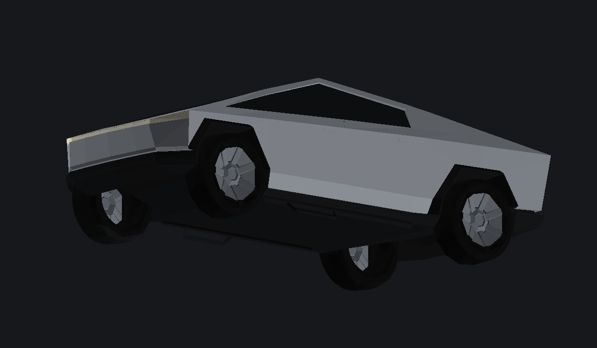

# CyberTruck mod for *Rohit Indian Bikes* (Android / AssetBundle)

A ready-to-build Unity project that produces the **AssetBundle** the game's mod loader
loads. The vehicle is **your uploaded `CyberTruck.fbx`, kept as it is** — same body, same
panels, same wheels — with only the technical changes the game rig needs (see §6) and a
proper material set.



---

## 1. What's in the box

```
CyberTruck_UnityProject/
├── Assets/
│   ├── CyberTruck/
│   │   ├── Models/CyberTruck.fbx        ← your model (2 082 body tris + 4 wheels)
│   │   ├── Materials/CyberTruck_*.mat   ← 6 materials (body, trim, light, tail, tyre, rim)
│   │   ├── Prefabs/CyberTruck.prefab    ← the mod prefab (asset name: CyberTruck)
│   │   ├── Prefabs/rgs.prefab           ← same prefab, the alias the old loader asks for
│   │   ├── Meshes/                      ← filled by the builder (step 1)
│   │   └── Docs/                        ← renders + MODEL_NOTES.md
│   ├── Editor/CyberTruckBuilder.cs      ← the build menu (steps 1-2-3)
│   ├── Scripts/Assembly-CSharp/…        ← the game scripts, unchanged
│   └── AudioClip/ Material/ Texture2D/ Shader/ GameObject/   ← support assets the prefab
│                                            still references (sounds, particles, shader)
├── Packages/manifest.json
├── ProjectSettings/      Unity 2021.3.45f1 · layer 9 = Vehicle · tag unknown_20004
└── README.md
```

The prefab keeps everything the game expects — `CarControl`, `CarSteer`, `RidingCar`
anchors, 4× `WheelCollider`, 4× `AudioSource`, exhaust `ParticleSystem`, `Projector`
headlights, `Camera` + `FlareLayer` + `AudioListener` + `Animator`, `color_select`,
`ExplosionVehicle`, `DestroyGameObject`, `CarImpactCheck`, `KillOnTrigger` — and every
script reference is resolved against the real script GUIDs. Validated after generation:
134 objects, 0 broken fileIDs, 0 component/type mismatches, 0 unresolvable asset GUIDs.

---

## 2. Build it (2 clicks)

1. Open the folder with **Unity 2021.3.45f1** (Android Build Support installed). On first
   load `CyberTruckBuilder` runs **step 1** by itself: imports the FBX at 1:1 metres,
   extracts `CyberTruck_Body` + `Wheel_FL/FR/RL/RR` into `Assets/CyberTruck/Meshes/`, and
   wires the meshes + 6 materials into the prefab.
2. Menu **`CyberTruck ▸ 2 · Build Android AssetBundle`**.

```
Build/Android/cybertruck          ← ship this (LZ4)
Build/Android/cybertruck.manifest
```

`CyberTruck ▸ 3 · Check vehicle rig` prints mass, wheel positions/radii, `CarControl`
values, mesh + material counts and the camera setup, so you can confirm step 1 ran before
building (if it didn't, the car is *invisible* — the MeshFilters point at generated
meshes).

> Step 2 switches the active build target to Android automatically; an Android IL2CPP
> player can't load a desktop bundle.

---

## 3. Install in the game

Copy `Build/Android/cybertruck` into the same mod folder the old `Truck` mod used, then in
the loader config (`rgs`: `fileName`, `assetNameToLoad`, `bundleFileTypes`, `folderPath`):

| field | value |
|---|---|
| `fileName` | `cybertruck` |
| `assetNameToLoad` | `CyberTruck` — or `rgs`, that alias prefab ships in the same bundle |
| `folderPath` | wherever you copied it |
| `bundleFileTypes` | unchanged |

---

## 4. Tuning (already in the prefab)

| what | value |
|---|---|
| top speed / reverse | **2000** / **500** |
| torque / gears | 68 000 · 400 / 800 / 1200 / 1600 / 2000 rpm |
| mass / drag / angularDrag | 3000 kg / 0.02 / 0.65 |
| collision | continuous dynamic + interpolation, no constraints |
| wheel radius / mass | 0.468 – 0.477 m (per wheel, = the mesh) / 45 kg |
| suspension | 0.30 m travel, spring 55 000, damper 6 500, target 0.45 |
| forward friction | extremumSlip 0.55, value 3.2, asymptote 1.2 / 2.6, stiffness 1.7 |
| sideways friction | extremumSlip 0.38, value 3.8, asymptote 0.85 / 3.0, stiffness 2.1 |
| camera distance (`CamDis`) | 7 |

Why it stays on the road at 2000: heavy body + stiff-but-damped springs (damping ratio
≈ 0.5), low centre of mass (0, 0.60, 0.10), high sideways friction so it can't slide out
sideways, continuous-dynamic collision so it can't tunnel through the road at speed, no
frozen axes, and a **`Player Protect`** box (1.85 × 1.45 × 2.40 m, non-trigger) around the
cab so the game never drops the rider out of the seat.

If a particular ramp still throws it: set suspension distance 0.24 and damper 9 000 — that
is the strongest anti-launch knob.

---

## 5. Cameras

| view | anchor | value |
|---|---|---|
| 3rd person | `Cam` + `CamDis` | (0, 1.45, 0.30), distance 7 |
| 1st person | `InteriorCam` | (−0.42, 1.32, 0.42) — driver's eye, LHD, pitch −2° |
| seat | `SitPosL` | (−0.42, 0.88, 0.20) |
| hands / feet | `steering_dummy` (−0.42, 1.04, 0.82) + `Steer` → `LeftHand`/`RightHand` (±0.26) · `LeftFoot`/`RightFoot` (±0.32, 0.16, 1.06) | |
| dials | `Speedometer` / `RPMSpeedometer` | (−0.28, 1.02, 0.86) / (−0.56, 1.02, 0.86) |

Camera: FOV 62°, near 0.05, far 1500, keeps the game's `FlareLayer`, `AudioListener` and
`Animator` so switching views doesn't break the player rig.

---

## 6. What was changed on the model (and what wasn't)

**Untouched:** every vertex, triangle, panel, wheel and light of the uploaded `CyberTruck.fbx`.
No reshaping, no added parts, no re-branding — 3 623 triangles in, 3 623 triangles out.

Only these changes, all of them required by the game rig:

1. **Axes / scale** — the source is `−X` forward, `+Y` up, `+Z` right in ~4× scale. Rotated
   to Unity space (**+Z forward, +Y up, +X right**), scaled ×0.2459 to real metres
   (**5.59 m long, 2.18 m wide, 1.79 m tall**, wheelbase 3.60 m), tyres on `y = 0`, axle
   midpoint on `z = 0`.
2. **Wheels split off** — the source is one welded mesh; the four wheels are now separate
   `Wheel_FL/FR/RL/RR` meshes centred on their hubs (axis on X) so the game can spin and
   steer them. Each wheel keeps all of its geometry; the tyre/rim material split is radial
   (inner 62 % = rim).
3. **Materials** — the six unnamed source slots (`…untitledglass…`, `…sid…`,
   `…bodyshell…`, …) became six named project materials: `CyberTruck_Body` (brushed
   stainless), `CyberTruck_Trim` (dark charcoal: sills, arches, bumper parts, interior,
   roof panel), `CyberTruck_Light` (emissive white — front light bar), `CyberTruck_Tail`
   (emissive red — rear light bar), `CyberTruck_Tire`, `CyberTruck_Rim`. Geometry-to-slot
   assignment is the source's own.
4. **Rig landmarks measured from the mesh** — wheel hubs, seat, camera, door, headlights and
   the collider boxes are placed from the actual geometry, not guessed (see §7).

> Fan-mod note: this is your own asset pipeline, non-commercial use. If you ever publish,
> keep it as a fan mod and don't present it as an official product.

Details and the measured numbers: [`Assets/CyberTruck/Docs/MODEL_NOTES.md`](Assets/CyberTruck/Docs/MODEL_NOTES.md).

---

## 7. Rig reference (metres, prefab-local, car faces +Z)

| part | position | notes |
|---|---|---|
| root `rgs` | origin, identity | layer 9, tag `unknown_20004` |
| `Wheel_FR` | (0.831, 0.487, 1.799) | r 0.476 |
| `Wheel_FL` | (−0.869, 0.463, 1.799) | r 0.468 |
| `Wheel_RR` | (0.899, 0.463, −1.800) | r 0.468 |
| `Wheel_RL` | (−0.860, 0.473, −1.799) | r 0.477 |
| box `body` | centre (0, 0.75, 0), size 2.05 × 1.50 × 5.35 | main collider |
| box `skirt` | centre (0, 0.32, 0), size 1.95 × 0.64 × 5.20 | anti-tuck |
| box `cabin` | centre (0, 1.00, 0.15), size 1.85 × 1.40 × 2.50 | trigger, rider detection |
| `Player Protect` | (0, 1.05, 0.20), 1.85 × 1.45 × 2.40 | keeps the rider in |
| `TriggerKill` | (0, 0.45, 2.25), 1.95 × 0.90 × 0.95 | front bump volume, trigger |
| `HeadLights` | (0, 1.02, 2.40) | on the front light bar |
| sounds | `EngineSound`/`EngineSound 2` (0, 0.55, 1.50) · `CrashSound` (0, 0.65, 0.60) | |

---

## 8. Troubleshooting

| symptom | fix |
|---|---|
| car is invisible | step 1 didn't run — `CyberTruck ▸ 1`, or delete `Assets/CyberTruck/Meshes` and reopen |
| car is pink | rerun step 1; `Assets/CyberTruck/Materials` must hold the 6 `CyberTruck_*` materials |
| car faces backwards | the FBX is authored for Unity's default RH→LH import (X is negated on import). If your Unity build has *Bake Axis Conversion* on, turn it off, or rotate the prefab root 180° on Y |
| wheels sit at the wrong end / mirrored | same cause — root Y rotation 180° fixes both |
| bundle loads, nothing spawns | wrong platform: step 2 must build with target Android |
| `CarControl` fields read 0 in game | `Assets/Scripts/Assembly-CSharp` must stay in the project, unedited |
| wheels spin the wrong way | flip the two `tireMeshes` entries' local X scale |
| Console warning CS0436 `UnityEngine.UI.Text` | harmless; comes from the reference project's `DummyTypes.cs` |

---

## 9. Verified / not verified

Verified here: prefab YAML valid (Unity 2021.3), 134 objects all resolving, 0 dangling
fileIDs, component→script types match the decompiled classes, all 36 asset GUIDs resolve
inside the project, FBX re-parsed and re-rendered after writing (5 meshes, 6 materials,
3 623 tris, bounds 2.18 × 1.79 × 5.59 m, tyres on y = 0).

Not verifiable here (no Unity in this sandbox): the in-editor import and in-game behaviour.
Step 3's rig report is the quickest check — if the meshes show non-NULL with 4 / 2
submeshes, the bundle is good.
